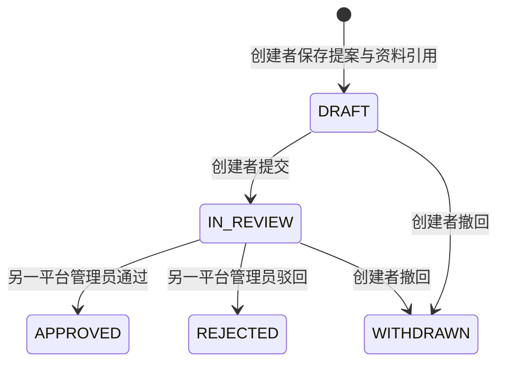

# 配置修订、书面资料引用与内部审批

实现日期：2026-10-01。范围为D04的一个独立切片：当前租户的配置提案、未核验外部证据引用、双主体内部审核和不可变流程历史。它不完成客户证据真实性验证、正式确认、生效或外部下发。

APPROVED只表示内部审核通过。全部修订仍为`confirmation_status=UNVERIFIED`、`effective_value=null`；原登记`value/decision_status`与旧建议草稿不变，正式发布继续返回CONFIG_PENDING。驳回/撤回/通过后的修订均不可再改；要调整则创建新提案，原历史保留。

## 接口与权限

|接口|行为|
|---|---|
|GET/POST /api/v1/configurations/{key}/revisions|读取本租户列表/创建独立提案|
|GET /api/v1/configuration-revisions/{id}|读取本租户详情、资料引用和完整历史|
|POST /api/v1/configuration-revisions/{id}/submit|创建者提交DRAFT，带expected_version|
|POST /api/v1/configuration-revisions/{id}/review|非创建者padmin通过/驳回，带expected_version、decision、comment|
|POST /api/v1/configuration-revisions/{id}/withdraw|创建者撤回DRAFT或IN_REVIEW，带expected_version和reason|

接口采用现有Cookie/CSRF、Idempotency-Key、trace_id及统一错误信封。主体从真实OIDC会话取得，租户从可信上下文取得；输入不能指定tenant_id、created_by、reviewed_by或确认状态。跨租户对象统一404，动作无权403，旧版本409，非法状态422。成功重放返回原响应，先复核现有授权，不增加历史或审计。

证据1至5项，每项只保存`document-ref:ASCII标识`、标题及64位十六进制SHA-256；禁止URL、磁盘路径及凭据正文。它不是附件上传或下载接口，不核验被引用资料确实存在，也不证明由客户签署。提案按原登记类型校验并拒绝常见秘密字段，固定约束禁止修改；reason/comment按Unicode code point限1至500。

审核权限本批沿用平台管理员能力，测试域新增第二padmin用于真实双主体验证。客户正式审批岗位仍按Q09确认；新增测试账号不代表正式岗位已获批准。

## 持久化及运行

V2新增租户联合定位的revision与history表。提案、创建人、租户和创建时间不可由运行账号UPDATE；history只能SELECT/INSERT。状态CAS、历史、成功审计及幂等响应同事务提交；拒绝不改变状态、版本或历史。并发读使用同一连接，历史限制到返回版本，避免旧状态带未来历史或嵌套连接池饥饿。

V3仅在指定`mop_test`数据库补充第二测试身份的签发者+sub映射，不改V1或客户生产身份。V2/V3已执行，后续结构修订必须新增迁移。

## 验证证据

本地应用连接原测试服务器的PostgreSQL与Keycloak，未另起数据库/身份组件。统一检查：18项Java纯单元、11项远程PG集成（新增修订6项）、前端15项、契约3项通过；历史fixture13项默认跳过。类型与构建通过，路由惰性加载后主包461.64kB，无包体警告。

`tests/configuration-revision-api.mjs`在三份真实OIDC会话下校验40个HTTP响应，覆盖全部五态、自审/伪造主体/跨租户/CSRF/旧版本拒绝、同键重放与异体冲突、单次历史/审计和原登记不生效。公开摘要为`docs/evidence/configuration-revision-http.json`，不含Cookie、token、密码或提案正文。

真实浏览器分别以创建者与复核身份完成提交/通过，自审入口隐藏；390px视口完成创建和撤回，文档宽度390px、确认表单宽366px，底部操作可达。截图仅保存在Git忽略的`.local/qa-configuration-revisions/`，不作为客户真实性证明。

复现时先按README准备私有测试环境，运行`deploy/check.ps1`并启动应用。分别用`capture-test-session.mjs padmin/reviewer/viewerA`获取真实会话，将会话复制至私有`qa-revision-creator/reviewer/viewer.json`后执行`node tests/configuration-revision-api.mjs`。私有文件不得提交；此脚本会在独立测试库留下明确虚构的提案与追加历史。
