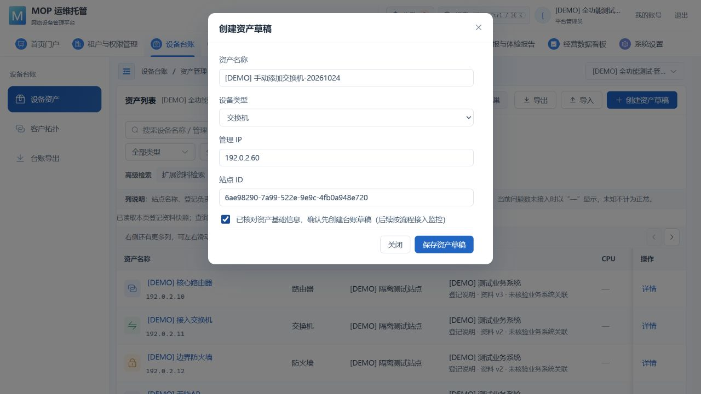
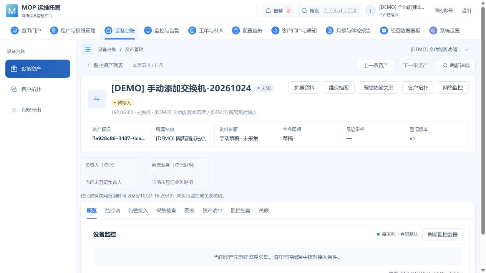
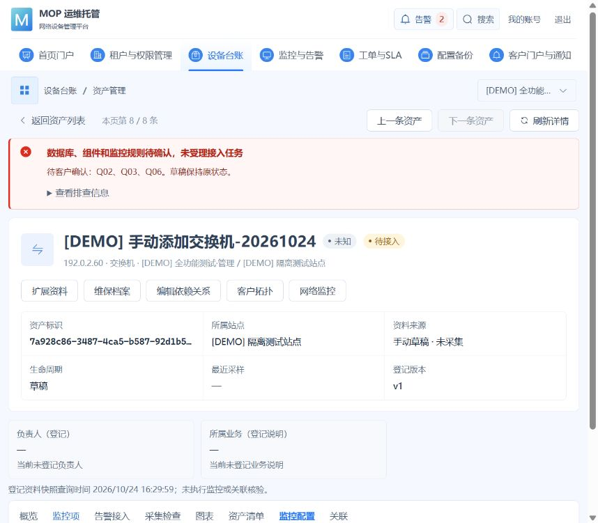
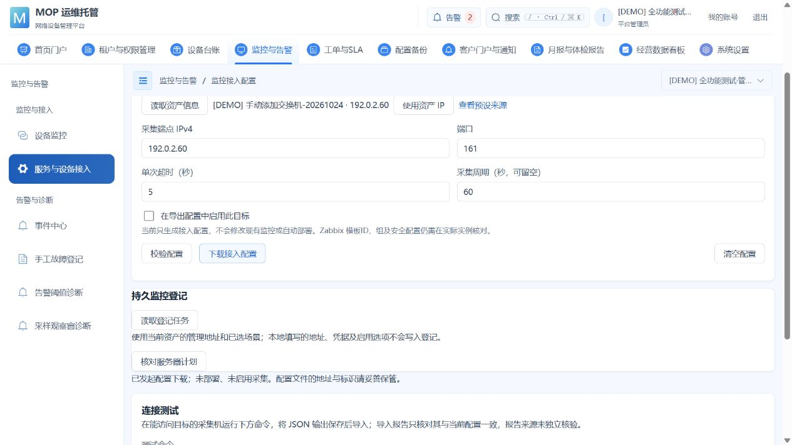
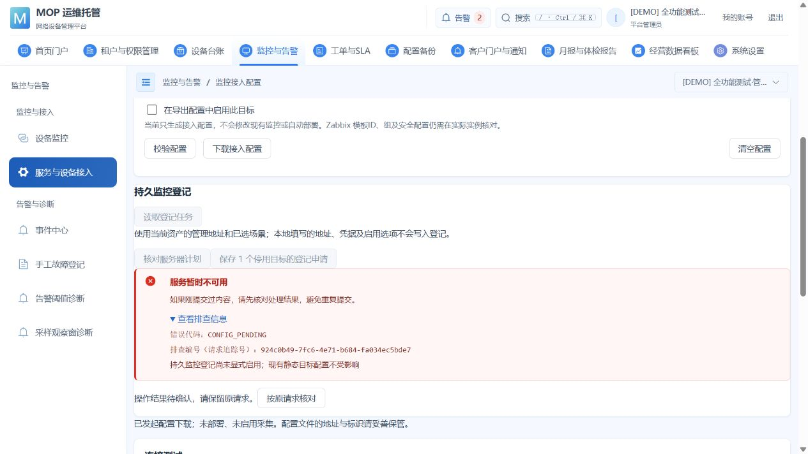
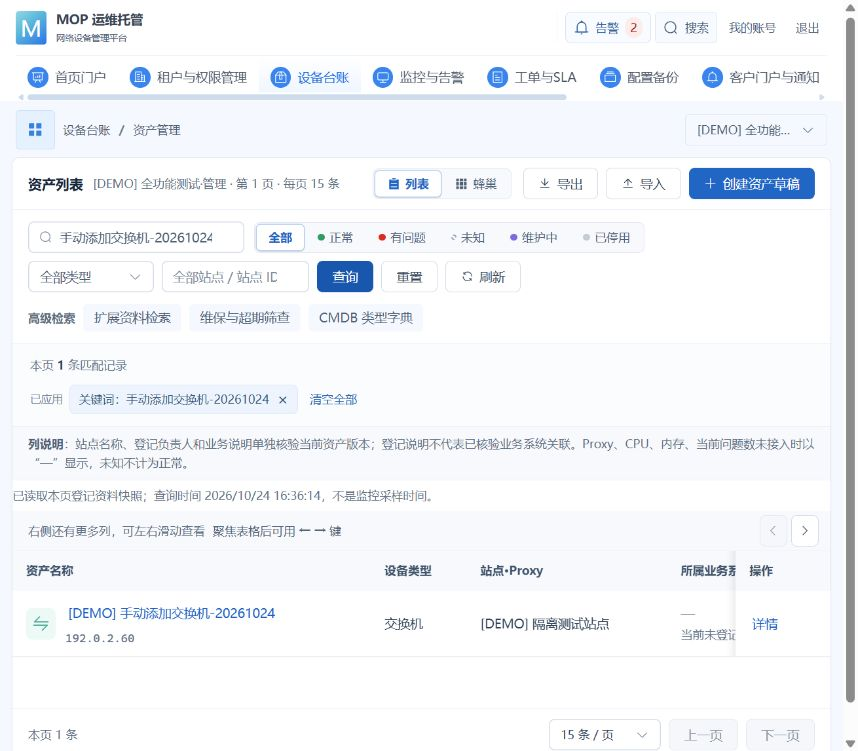
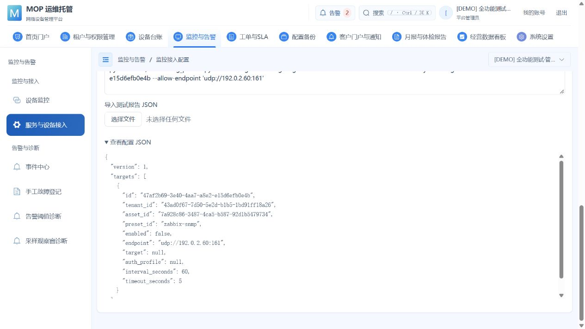
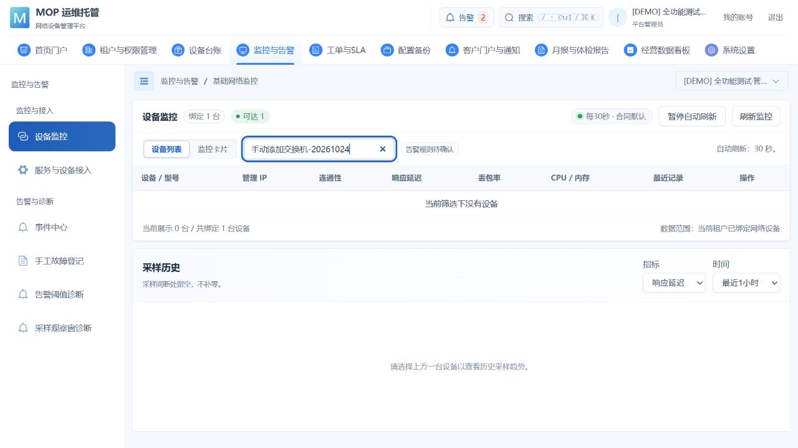

# 手动添加设备到监控的实际流程测试

2026-10-24，用户要求“测试手动添加，展示全流程”。本轮在实际部署的 MOP Web 页面逐步操作，使用既有 `demo_full` 和 `[DEMO] 全功能测试·管理` 隔离租户。**手动资产添加、保存回读及配置生成通过；接入检查和持久登记存在明确门禁，尚未形成新增设备的持续采集闭环。**

## 环境与范围

项目为众安在线 MOP；规范 origin `https://github.com/yangyour/zhonganzaixian.git`，组织路径 `yangyour/zhonganzaixian`。独立目录 `E:\work\wxw9\zhonganzaixian\.worktrees\device-monitoring-20261024`，本轮分支 `codex/manual-device-flow-20261024`、初始上游 `origin/main`，起点 `22a7638b`；原主目录三处未提交前端文件保持。本轮沿用上次已核验的仓库和私有连接资料，提交前再次 fetch 及核对 Git 配置。

浏览器访问 `http://mop.all-online.com.cn`，实际部署 API0.85.0/V55；复用指定测试服务器现有 PostgreSQL 与监控。没有模拟 API、注入假响应、部署、迁移、修改运行开关或设备策略。保存前取得共享 `environment.lock`，完成保护摘要和数据库回读后释放自己的锁。曾遇其他会话持锁，期间只填写表单及读取页面，原锁释放后才提交。

测试资产名称 `[DEMO] 手动添加交换机-20261024`，管理地址 `192.0.2.60` 为文档测试地址，未当作现场实物或发起网络探测。资产 ID `7a928c86-3487-4ca5-b587-92d1b5479734`，隔离租户 `43ad0f67-7d50-5e2d-b1b5-1bd91ff18a26`，站点 `6ae98290-7a99-522e-9e9c-4fb0a948e720`。真实设备租户没有新增虚构资产、采样或登记。

实际创建时间 2026-10-24 **04:29:47 EDT**。原始截图保留页面自己的时间显示设置，未修改图中文字或像素；页面显示时间与本报告 EDT 口径分别保留。原始截图尺寸随可见浏览器面板变化，本轮不是固定视口/移动端或完整可访问性验收。

## 逐步实际结果

| 步骤 | 实际操作与结果 | 状态 |
| --- | --- | --- |
| 1 登录与租户核对 | 既有隔离账号登录，从客户场景切换到管理场景；初始该租户7条资产 | 通过 |
| 2 手动录入 | 资产台账 → 创建资产草稿；填写名称、交换机、管理IP、站点ID，勾选“确认仅创建资产草稿” | 通过 |
| 3 保存 | 单次点击保存，成功进入新资产详情；显示来源“手动草稿·未采集”、草稿、未知、待接入、v1 | 通过 |
| 4 持久回读 | 刷新详情、返回列表、按名称查询，准确返回1条；数据库确认新增1行，租户资产数7→8 | 通过 |
| 5 接入条件 | 详情 → 监控配置 → 检查接入条件；显示“数据库、组件和监控规则待确认，未受理接入任务”，列出Q02/Q03/Q06 | 阻塞，原草稿保持 |
| 6 监控配置 | 服务与设备接入 → 网络设备/Zabbix SNMP；读取新资产、使用资产IP，端口161，测试周期60秒、超时5秒，输出启用选项不勾选 | 通过 |
| 7 校验与导出 | 页面提示“配置格式校验通过，尚未联网或部署”；点击下载后提示已发起下载；展开JSON并保存其实际文本副本 | 格式通过；下载动作已发起 |
| 8 服务器计划 | “核对服务器计划”返回1个停用目标的登记申请入口 | 计划生成通过，不表示登记/采集 |
| 9 服务器目录 | “读取登记目标”返回CONFIG_PENDING：“服务器尚未配置登记目标目录” | 阻塞 |
| 10 持久登记 | “读取登记任务”失败；点击“保存1个停用目标的登记申请”仍CONFIG_PENDING：“持久监控登记尚未显式启用；现有静态目标配置不受影响” | 未受理；本租户登记和修订均0行 |
| 11 最终监控列表 | 搜索新设备，显示当前筛选下没有设备；该租户仍只有原测试服务器1条监控绑定 | 新设备未采集，未冒充正常 |

测试没有批准规则、添加设备凭据或启用额外采集。`interval_seconds=60` 与 `timeout_seconds=5` 仅为本次停用配置输入，不发布客户生产参数。

## 图文过程

**手动填写。** 保存动作要求核对基础资料并明确仅创建草稿。

**保存成功。** 新资产详情显示草稿、未知、待接入，未填造采样时间。

**检查接入条件。** Q02、Q03、Q06门禁明确返回，原草稿保持。

**读取资产并生成监控配置。** 场景为Zabbix SNMP，地址来自实际保存的资产，目标保持停用。

**保存登记的实际阻塞。** 展开排查信息可以看到未启用的具体原因。

**列表回读。** 关键字查询返回准确的1条新资产。

**实际配置JSON。** `enabled=false`，没有内联凭据。原始文本见[配置副本](evidence/manual-device-flow-20261024/generated-config.json)。

**最终采集结果。** 监控列表按新设备名查询为0条，未用既有测试服务器的采样冒充新设备数据。

## 数据保护、回执与工具校验

- 指定PostgreSQL只读回查：测试资产只有1行，`lifecycle_status=DRAFT / source=manual / status=unknown / availability=UNKNOWN / sync_state=PENDING_ONBOARDING / version=1 / sampled_at=null`。
- 本租户 `mop_monitoring_enrollment` 与 `mop_monitoring_enrollment_revision` 均为0行。当前部署控制器在持久登记开关关闭时，于幂等写入和业务仓储之前返回CONFIG_PENDING；原请求未进入登记写入。真实审计有 `asset.create_draft / SUCCEEDED`（该隔离租户sequence178）。
- 真实设备两处受保护租户的资产、成员、站点、项目角色、成员角色及邮件/企微绑定等7张保护表摘要前后相同；V55完整迁移历史相同。见[前摘要](evidence/manual-device-flow-20261024/before.json)、[后摘要](evidence/manual-device-flow-20261024/after.json)。只新增上述隔离资产及正常操作审计，未删除测试资产或改写审计。
- 页面实际JSON副本又通过原CLI校验：`py -3.14 -X utf8 tools/monitoring_presets.py validate --config docs/evidence/manual-device-flow-20261024/generated-config.json`；valid=true，target_count=1，network_accessed=false。配置规范摘要 `c4608c8f666c1fb73de3c52590daa0843363b3e9d5f42903e1f0430d9214f208`。
- 首次Windows命令未加UTF-8模式，原CLI按系统GBK读取中文目录时抛UnicodeDecodeError；本次使用进程级 `-X utf8` 完成校验，没有改系统编码或把失败算通过。浏览器点击下载仅确认动作已发起，未独立核验浏览器下载目录中的文件；交付的JSON是展开页面实际内容的副本。
- 浏览器自动化曾在刷新卸载控件期间定位超时，并遇details摘要不匹配button角色；重新读取当前页面后通过实际控件完成，未调用隐藏接口代替提交或绕过门禁。这些工具定位失败不作为产品通过项。
- 密码只从原Git忽略私有文件读入登录控件，截图均为登录后业务页。没有将口令、token或会话保存到截图、公开记录或提交。

## 本轮确认的剩余链路

1. 资产详情的旧接入入口仍以Q02/Q03/Q06返回门禁，实际PG及Zabbix可用性不能代替这些规则的批准。
2. 服务器静态目标目录未配置，持久监控登记开关未启用，页面配置生成与实际登记/发布之间尚有运行接线条件。
3. 本轮503后页面保留“操作结果待确认”和原请求，编辑/保存控件锁定；未自动重放或清除原命令。现场已保留，后续需区分已明确未受理的配置门禁和真正的传输结果未知。
4. 后续还需已授权的采集位置、只读认证、模板/对象映射、明确审批与发布、真实首值及历史、失败恢复验证。本次测试地址没有现场设备，网络/SNMP首值和新设备持续采集均NOT_RUN。

本轮没有更改代码、生产开关、凭据、真实设备策略或服务生命周期。结论为**手动添加及配置准备已验证，自动接入与持续采集闭环仍阻塞**；不登记为完整M02/M4或128项正式验收通过。
